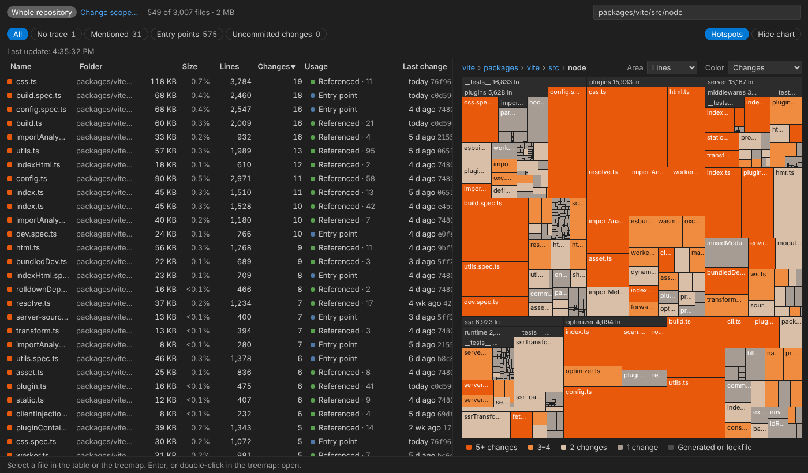

# Heftmap — qué pesa en tu repo y si se usa

Heftmap enseña cuánto pesa cada archivo y carpeta, qué recursos ya no referencia nadie y dónde está
el código grande que más se toca. Pensada para proyectos web con recursos pesados (modelos `.glb`,
audio, texturas), sirve en cualquier repo con git, también en monorepos.

[English](README.md) · [Euskara](README.eu.md)

## Qué hace

- **Vista «Carpetas»** en la barra lateral: tamaño y porcentaje de cada carpeta y archivo, con
  barra de peso, color para lo que más pesa y casillas para acotar el análisis a unas carpetas.
- **Panel con tabla y treemap**, enlazados en los dos sentidos. Todos los archivos en una tabla
  ordenable y filtrable. Área del treemap por bytes, √bytes o líneas; color por extensión, uso,
  antigüedad, commits recientes o frecuencia de cambio.
- **Uso**: quién referencia cada archivo (imports, rutas en strings, `url()`, `src`/`href`, enlaces
  de Markdown, `import.meta.glob`) y qué recursos no tienen **ningún rastro**. Para esos: ignorar o
  mover a la papelera (siempre pregunta antes).
- **Git**: último commit de cada archivo, cambios sin commit y diff.
- **Hotspots**: un botón cruza líneas y nº de cambios para encontrar el código grande que no para
  de cambiar.

## Qué no hace

- No detecta código muerto: en código, «Sin importadores» es un aviso de baja confianza (las
  rutas de un framework, por ejemplo, no las importa nadie). Para eso está [Knip](https://knip.dev).
- No borra nada sin preguntar.
- No envía nada a ningún sitio: todo se calcula en local con tus archivos y `git`. Sin telemetría
  ni peticiones de red.

## Requisitos

- Cursor, VS Code 1.85 o posterior, o cualquier editor que instale desde Open VSX.
- `git` en el `PATH` para el historial y los cambios. Sin git, Heftmap enseña tamaños y uso.
- En modo restringido (carpetas sin confianza) Heftmap no ejecuta git. Ver [SECURITY.md](SECURITY.md).

## Ajustes

| Ajuste | Por defecto | Para qué |
|--------|-------------|----------|
| `heftmap.language` | `auto` | `en`, `es` o `eu`; `auto` sigue al editor |
| `heftmap.publicDir` | `public` | Carpeta contra la que se resuelven las rutas absolutas (`/models/x.glb`) |
| `heftmap.git.since` | vacío | Limitar el historial en repos grandes, p. ej. `1.year` |
| `heftmap.usage.ignore` | `[]` | Archivos que nunca cuentan como huérfanos |
| `heftmap.usage.entryPoints` | `[]` | Puntos de entrada extra (rutas de un framework, por ejemplo) |
| `heftmap.refreshDelay` | `1500` | Milisegundos de espera tras un cambio antes de volver a analizar (250–60000) |
| `heftmap.autoRefresh` | `true` | Volver a analizar automáticamente al cambiar archivos o git; desactivado = solo con Refrescar |
| `heftmap.maxTextFileSize` | `5` | Los textos de más de este tamaño (MB) no se leen: sin líneas ni uso (1–50) |
| `heftmap.usage.weakSources` | `["scripts", "tools", "bin"]` | Carpetas de tooling: lo que nombran cuenta como mención, no como uso |

## Monorepos

Cada app usa su propio `tsconfig.json` (alias como `@/…`), y los paquetes del repo importados por
nombre (`@scope/pkg`) se resuelven a su código fuente, con o sin `node_modules`. Los alias que solo
están en la configuración del bundler (Vite, Metro, Babel) no se pueden seguir: el registro
(*Output → Heftmap*) los lista, y declararlos en `paths` de un tsconfig lo arregla.

## Límites conocidos

- Cada cambio en disco vuelve a analizar el repo en segundo plano. El análisis incremental está
  planificado.
- En un workspace con varias carpetas raíz solo se analiza la primera.
- Un archivo renombrado empieza a contar cambios desde cero.

## Problemas

El registro está en *Output → Heftmap*. Si Heftmap falla lo dice y ofrece **Copiar informe**: pégalo en
una [incidencia](https://github.com/davidcirosierrra/Heft/issues). Problemas de seguridad: ver
[SECURITY.md](SECURITY.md).

## Licencia

[MIT](LICENSE)
