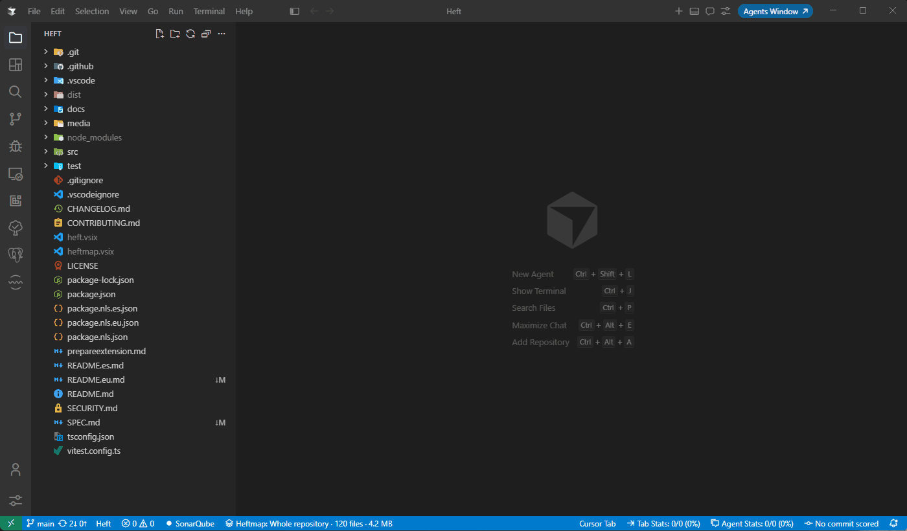
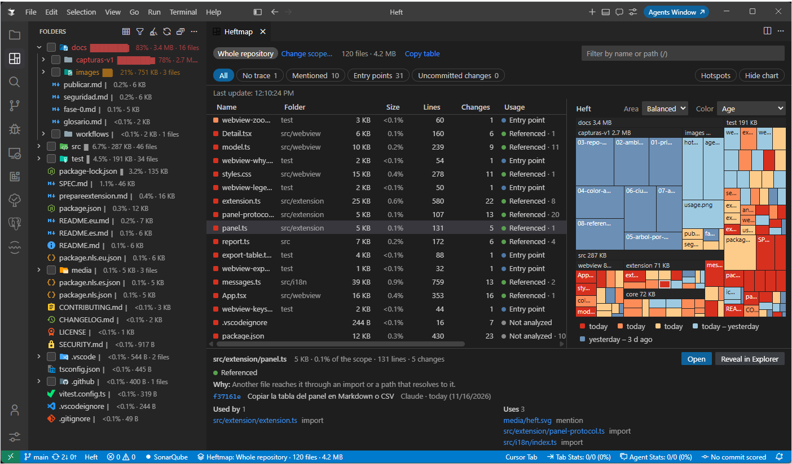
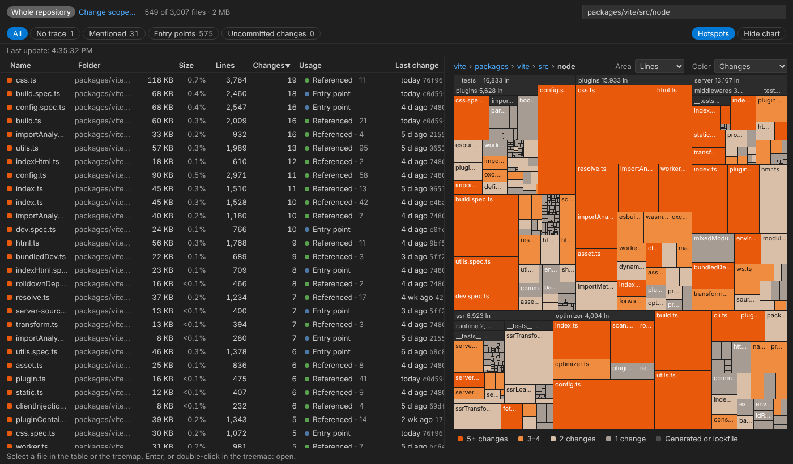

# Heftmap — zerk pisatzen duen zure biltegian eta erabiltzen den

Heftmap-ek fitxategi eta karpeta bakoitzaren pisua erakusten du, inork erreferentziatzen ez dituen
baliabideak, eta gehien aldatzen den kode handia non dagoen. Baliabide astunak dituzten web
proiektuetarako pentsatua (`.glb` modeloak, audioa, testurak), git duen edozein biltegitan
balio du, monorepoetan ere bai.

[English](README.md) · [Español](README.es.md)

## Zer egiten du

- **«Karpetak» ikuspegia** alboko barran: karpeta eta fitxategi bakoitzaren tamaina eta
  ehunekoa, pisu-barrarekin, gehien pisatzen duenarentzat kolorearekin eta azterketa karpeta
  batzuetara mugatzeko kontrol-laukiekin.
- **Panela taula eta treemap-arekin**, bi noranzkoetan lotuta. Fitxategi guztiak taula
  ordenagarri eta iragazgarri batean. Treemap-aren azalera byteen, √byteen edo lerroen arabera;
  kolorea luzapenaren, erabileraren, antzinatasunaren, azken commiten edo aldaketa-maiztasunaren
  arabera.
- **Erabilera**: nork erreferentziatzen duen fitxategi bakoitza (importak, bide-izenak testuan,
  `url()`, `src`/`href`, Markdown estekak, `import.meta.glob`) eta zein baliabidek ez duten
  **arrastorik**. Horientzat: baztertu edo zakarrontzira eraman (beti galdetzen du lehenago).
- **Git**: fitxategi bakoitzaren azken commita, commit gabeko aldaketak eta diff-a.
- **Hotspot-ak**: botoi batek lerroak eta aldaketa kopurua gurutzatzen ditu, aldatzen jarraitzen
  duen kode handia aurkitzeko.

## Panelean

- **Karpeta batera zooma**: egin klik haren goiburuan treemap-ean. Taulak eta guztizkoek karpeta
  hori bakarrik erakusten dute, eta «Zooma: karpeta/ ✕» txipak azaltzen du zergatik dauden
  errenkada gutxiago. ✕-k edo Escape-k zoometik ateratzen dute.
- **Legendako talde baten arabera iragazi**: egin klik talde batean (luzapen bat, erabilera-egoera
  bat, antzinatasun-tarte bat…). Treemap-ak nabarmentzen du eta taulak haren fitxategiak bakarrik
  uzten ditu, «Taldea: X ✕» txiparekin. Beste klik batek edo ✕-k dena erakusten dute.
- **Zergatik**: fitxategiaren xehetasunak dio zein arauk erabaki duen haren erabilera-egoera
  («Zergatik: ez dago hura erreferentziatzen edo bere izena aipatzen duen fitxategirik»).
- **Kopiatu taula**: ikusten diren errenkadak kopiatzen ditu, Markdown formatuan (issue edo PR
  baterako) edo CSV formatuan (kalkulu-orri baterako). *Heftmap: Kopiatu taula…* komandoak gauza
  bera egiten du; panela itxita badago, esparru osoa kopiatzen du.
- **Lehen urratsak**: *Help: Welcome* → «Lehen urratsak Heftmap-ekin»: panela, esparrua,
  arrastorik gabeko fitxategiak eta hotspot-ak.

## Teklatua

| Teklak | Non | Zer egiten du |
|--------|-----|---------------|
| `Ctrl+Shift+Alt+H` (`Cmd+Ctrl+Shift+H` Mac-en) | Edonon | Panela irekitzen du |
| `/` | Panela | Iragazkira eramaten du |
| `Escape` | Panela, iragazkitik kanpo | Zoometik ateratzen du |
| `↑ ↓`, `Page Up/Down`, `Home/End` | Taula | Hautapena mugitzen du |
| `Enter` | Taula | Hautatutako fitxategia irekitzen du |
| `← →`, `Home` | Zatitzailea | Zabalera banatzen du taularen eta grafikoaren artean; `Home`-k edo klik bikoitzak hasierakora itzultzen dute |

## Zer ez du egiten

- Ez du kode hila detektatzen: kodean, «Inportatzailerik gabe» konfiantza txikiko abisua da
  (framework baten bideak, adibidez, ez ditu inork inportatzen). Horretarako, [Knip](https://knip.dev).
- Ez du ezer ezabatzen galdetu gabe.
- Ez du ezer inora bidaltzen: dena lokalean kalkulatzen da zure fitxategiekin eta `git`-ekin.
  Telemetriarik eta sare-eskaerarik gabe.

## Baldintzak

- VS Code 1.85 edo berriagoa (Visual Studio Marketplace), Cursor edo Open VSX-etik instalatzen duen edozein editore.
- `git` `PATH`-ean, historiarako eta aldaketetarako. Git gabe, Heftmap-ek tamainak eta erabilera
  erakusten ditu.
- Modu mugatuan (konfiantzarik gabeko karpetak) Heftmap-ek ez du git exekutatzen. Ikus [SECURITY.md](SECURITY.md).

## Ezarpenak

| Ezarpena | Lehenetsia | Zertarako |
|----------|------------|-----------|
| `heftmap.language` | `auto` | `en`, `es` edo `eu`; `auto`-k editorea jarraitzen du |
| `heftmap.publicDir` | `public` | Bide-izen absolutuak (`/models/x.glb`) ebazteko karpeta |
| `heftmap.git.since` | hutsik | Git historia mugatu biltegi handietan, adib. `1.year` |
| `heftmap.usage.ignore` | `[]` | Inoiz umezurtz gisa kontatzen ez diren fitxategiak |
| `heftmap.usage.entryPoints` | `[]` | Sarrera-puntu gehigarriak (framework baten bideak, adibidez) |
| `heftmap.refreshDelay` | `1500` | Aldaketa baten ondoren berriro aztertu aurretik itxarotekoa, milisegundotan (250–60000) |
| `heftmap.autoRefresh` | `true` | Berriro aztertu bere kabuz fitxategiak edo git aldatzean; desaktibatuta = Freskatu-rekin bakarrik |
| `heftmap.maxTextFileSize` | `5` | Tamaina hau (MB) baino handiagoak diren testuak ez dira irakurtzen: lerrorik eta erabilerarik gabe (1–50) |
| `heftmap.usage.weakSources` | `["scripts", "tools", "bin"]` | Tooling karpetak: izendatzen dutena aipamena da, ez erabilera |
| `heftmap.exclude` | `[]` | Erabat kanpoan uzten dena, .gitignore-n bezala (`*.snap`, `fixtures`, `docs/images`) |
| `heftmap.hotspots.exclude` | `[]` | Hotspot-etatik kanpo uzten den kodea, `heftmap.exclude`-ren eredu berberak |
| `heftmap.panel.defaultArea` | `bytes` | Treemap-aren azalera panela irekitzean: `bytes`, `balanced` edo `lines` |
| `heftmap.panel.defaultColor` | `ext` | Kolorea panela irekitzean: `ext`, `usage`, `age`, `recent` edo `changes` |

## Monorepoak

Aplikazio bakoitzak bere `tsconfig.json` erabiltzen du (`@/…` bezalako aliasak), eta izenez
inportatutako biltegiko paketeak (`@scope/pkg`) bere iturburu-kodera ebazten dira, `node_modules`
izan zein ez. Bundler-aren konfigurazioan bakarrik dauden aliasak (Vite, Metro, Babel) ezin dira
jarraitu: erregistroak (*Output → Heftmap*) zerrendatzen ditu, eta tsconfig baten `paths` atalean
deklaratzeak konpontzen du.

## Muga ezagunak

- Diskoko aldaketa bakoitzak biltegia berriro aztertzen du atzeko planoan. Azterketa
  inkrementala aurreikusita dago.
- Erro-karpeta bat baino gehiagoko lan-eremuan, lehenengoa bakarrik aztertzen da.
- Izena aldatutako fitxategi batek aldaketak zerotik kontatzen hasten da.

## Arazoak

Erregistroa *Output → Heftmap* atalean dago. Heftmap-ek huts egiten badu, esan egiten du eta
**Kopiatu txostena** eskaintzen du: itsatsi [intzidentzia](https://github.com/notime-labs/heftmap/issues)
batean. Segurtasun-arazoak: ikus [SECURITY.md](SECURITY.md).

## Laguntzea

Akatsak, itzulpenak eta pull requestak ongi etorriak dira: ikus [CONTRIBUTING.md](CONTRIBUTING.md) (ingelesez).

## Lizentzia

[MIT](LICENSE)
