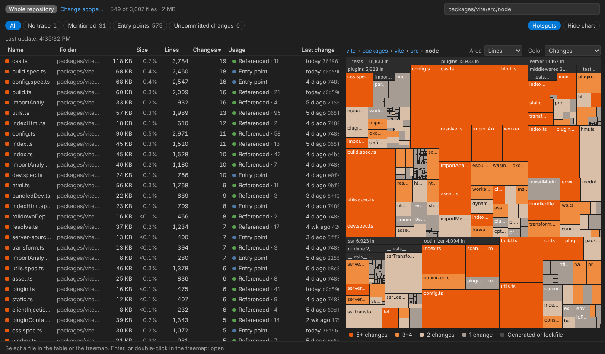
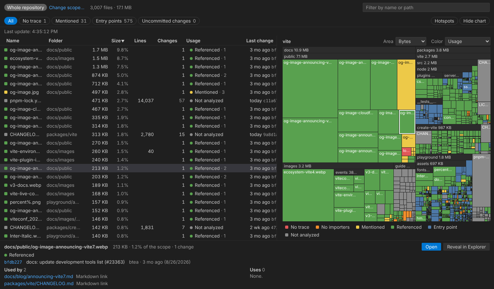

# Heftmap — what's heavy in your repo, and is it used?

Heftmap shows how much each file and folder weighs, which assets nobody references any more, and
where the big code that changes most lives. Built for web projects with heavy assets (`.glb`
models, audio, textures), useful in any git repository, including monorepos.

[Español](README.es.md) · [Euskara](README.eu.md)

## What it does

- **Folders view** in the side bar: size and share of every folder and file, with a weight bar,
  colour for the heaviest items and checkboxes to narrow the analysis to some folders.
- **Panel with a table and a treemap**, linked both ways. Every file in one sortable, filterable
  table. Treemap area by bytes, √bytes or lines; colour by extension, usage, age, recent commits
  or how often it changes.
- **Usage**: who references each file (imports, paths in strings, `url()`, `src`/`href`, Markdown
  links, `import.meta.glob`) and which assets have **no trace** at all. For those: ignore, or move
  to the trash (always asks first).
- **Git**: last commit of every file, uncommitted changes and diff.
- **Hotspots**: one button crosses lines and number of changes to find large code that keeps
  changing.

## What it doesn't do

- It isn't a dead-code detector. For code, «No importers» is a low-confidence hint (framework
  routes, for example, are never imported). Use [Knip](https://knip.dev) for dead code.
- It never deletes anything without asking.
- It sends nothing anywhere: everything is computed locally from your files and `git`. No
  telemetry, no network requests.

## Requirements

- Cursor, VS Code 1.85 or later, or any editor that installs from Open VSX.
- `git` in the `PATH` for history and changes. Without git, Heftmap still shows sizes and usage.
- In Restricted Mode (untrusted folders) Heftmap does not run git. See [SECURITY.md](SECURITY.md).

## Settings

| Setting | Default | What for |
|---------|---------|----------|
| `heftmap.language` | `auto` | `en`, `es` or `eu`; `auto` follows the editor |
| `heftmap.publicDir` | `public` | Folder that absolute paths (`/models/x.glb`) resolve against |
| `heftmap.git.since` | empty | Limit the git history in large repos, e.g. `1.year` |
| `heftmap.usage.ignore` | `[]` | Files that never count as orphans |
| `heftmap.usage.entryPoints` | `[]` | Extra entry points (framework routes, for example) |
| `heftmap.refreshDelay` | `1500` | Milliseconds to wait after a change before analyzing again (250–60000) |
| `heftmap.autoRefresh` | `true` | Analyze again automatically when files or git change; off = only with Refresh |
| `heftmap.maxTextFileSize` | `5` | Text files above this size (MB) are not read: no lines, no usage (1–50) |
| `heftmap.usage.weakSources` | `["scripts", "tools", "bin"]` | Tooling folders: what they name counts as a mention, not as use |
| `heftmap.exclude` | `[]` | What to leave out completely, as in .gitignore (`*.snap`, `fixtures`, `docs/images`) |
| `heftmap.hotspots.exclude` | `[]` | Code left out of the hotspots, same patterns as `heftmap.exclude` |

## Monorepos

Each app uses its own `tsconfig.json` (aliases like `@/…`), and packages of the repo imported by
name (`@scope/pkg`) resolve to their source, with or without `node_modules`. Aliases defined only
in a bundler config (Vite, Metro, Babel) can't be followed: the log (*Output → Heftmap*) lists them,
and declaring them in a tsconfig `paths` fixes it.

## Known limits

- Every change on disk re-analyzes the repo in the background. Incremental analysis is planned.
- In a multi-root workspace only the first folder is analyzed.
- A renamed file starts counting changes from zero.

## Problems

*Output → Heftmap* has the log. If Heftmap fails it says so and offers **Copy report**: paste it into an
[issue](https://github.com/davidcirosierrra/Heft/issues). Security problems: see
[SECURITY.md](SECURITY.md).

## License

[MIT](LICENSE)
